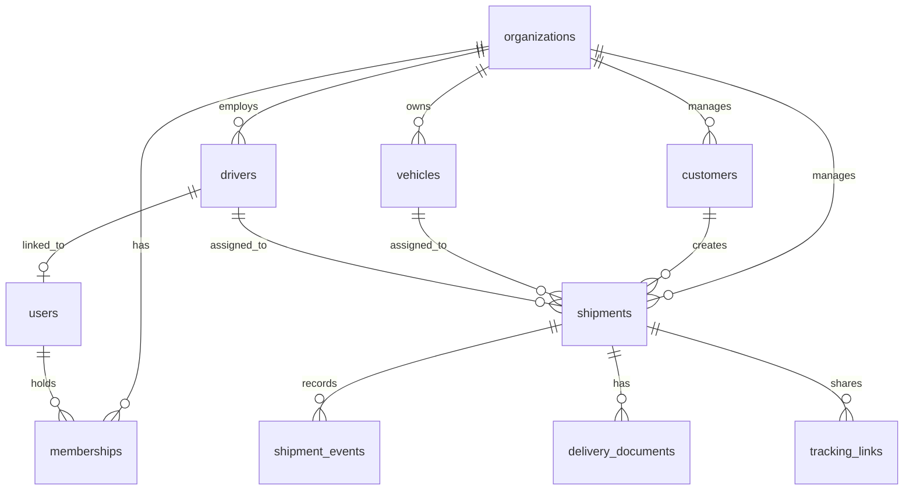

# Database Schema & Data Model

## Core Entities
- `organizations`: Multi-tenant boundary.
- `users`: Managed by Supabase Auth (references `auth.users`).
- `memberships`: Associates users with organizations and assigns roles (`admin`, `dispatcher`, `driver`).
- `customers`: Associated with organizations.
- `vehicles`: Fleet assets (type, capacity, status).
- `drivers`: Personnel, linked to users for auth.
- `shipments`: Core business entity (origin, destination, status, assignments).
- `shipment_events`: Audit trail for timeline.
- `delivery_exceptions`: Issues reported during transit.
- `delivery_documents`: Proof of delivery, references to Supabase Storage.
- `tracking_links`: Shareable links for customer visibility.
- `audit_logs`: Immutable logs for significant actions.
- `idempotency_records`: Protects non-idempotent mutations.

## Shipment Lifecycle States
`draft` -> `assigned` -> `picked_up` -> `in_transit` -> `delivered` (or `cancelled`)

## ER Diagram (Mermaid)

